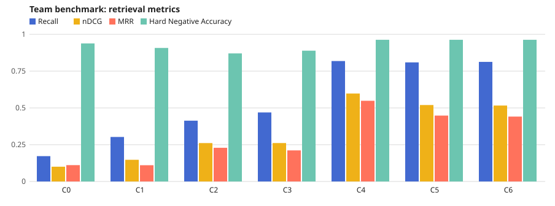
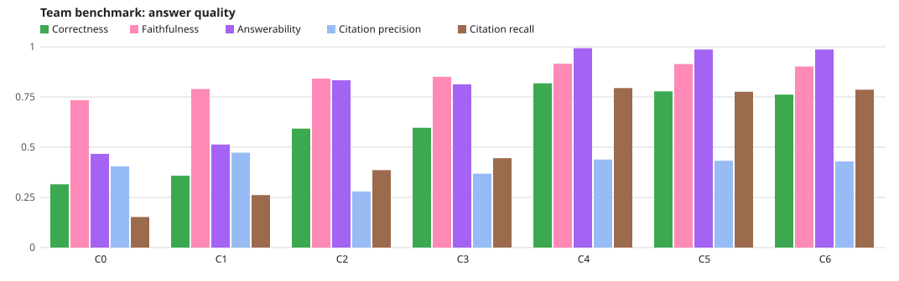
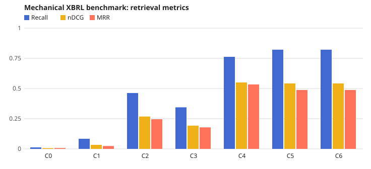

# Results: full-matrix-20261017

## Team benchmark

| Configuration | Name | Questions | Relevance-scored | Recall | nDCG | MRR | Hard negatives | Hard Negative Accuracy |
| --- | --- | ---: | ---: | ---: | ---: | ---: | ---: | ---: |
| C0 | naive BM25 | 150 | 146 | 0.1723 | 0.1004 | 0.1111 | 27 | 0.9383 |
| C1 | section-aware BM25 | 150 | 146 | 0.3025 | 0.1474 | 0.1105 | 27 | 0.9074 |
| C2 | dense retrieval | 150 | 146 | 0.4132 | 0.2610 | 0.2289 | 27 | 0.8704 |
| C3 | hybrid retrieval | 150 | 146 | 0.4692 | 0.2612 | 0.2113 | 27 | 0.8889 |
| C4 | hybrid retrieval with metadata filters | 150 | 146 | 0.8185 | 0.5978 | 0.5484 | 27 | 0.9630 |
| C5 | C4 + experimental MiniLM reranking | 150 | 146 | 0.8094 | 0.5195 | 0.4478 | 27 | 0.9630 |
| C6 | C5 + filing decomposition and verification | 150 | 146 | 0.8128 | 0.5160 | 0.4411 | 27 | 0.9630 |

### Answer quality

| Configuration | Name | Outputs | Correctness | Correctness scored | Faithfulness | Faithfulness scored | Answerability | Answerability scored | Citation precision | Citation precision scored | Citation recall | Citation recall scored | Claim checks |
| --- | --- | ---: | ---: | ---: | ---: | ---: | ---: | ---: | ---: | ---: | ---: | ---: | --- |
| C0 | naive BM25 | 150 | 0.3152 | 150 | 0.7344 | 66 | 0.4667 | 150 | 0.4046 | 66 | 0.1523 | 146 | not_run 66 |
| C1 | section-aware BM25 | 150 | 0.3579 | 150 | 0.7900 | 73 | 0.5133 | 150 | 0.4727 | 73 | 0.2614 | 146 | not_run 73 |
| C2 | dense retrieval | 150 | 0.5925 | 150 | 0.8417 | 121 | 0.8333 | 150 | 0.2791 | 121 | 0.3858 | 146 | not_run 121 |
| C3 | hybrid retrieval | 150 | 0.5969 | 150 | 0.8508 | 118 | 0.8133 | 150 | 0.3680 | 118 | 0.4452 | 146 | not_run 118 |
| C4 | hybrid retrieval with metadata filters | 150 | 0.8182 | 150 | 0.9157 | 145 | 0.9933 | 150 | 0.4385 | 145 | 0.7945 | 146 | not_run 145 |
| C5 | C4 + experimental MiniLM reranking | 150 | 0.7782 | 150 | 0.9142 | 144 | 0.9867 | 150 | 0.4325 | 144 | 0.7763 | 146 | not_run 144 |
| C6 | C5 + filing decomposition and verification | 150 | 0.7619 | 150 | 0.9019 | 144 | 0.9867 | 150 | 0.4289 | 144 | 0.7865 | 146 | mismatch 22, supported 40, unchecked 28, unverified 54 |

## Mechanical XBRL benchmark

| Configuration | Name | Questions | Relevance-scored | Recall | nDCG | MRR |
| --- | --- | ---: | ---: | ---: | ---: | ---: |
| C0 | naive BM25 | 1884 | 1884 | 0.0124 | 0.0064 | 0.0072 |
| C1 | section-aware BM25 | 1884 | 1884 | 0.0838 | 0.0335 | 0.0237 |
| C2 | dense retrieval | 1884 | 1884 | 0.4628 | 0.2681 | 0.2455 |
| C3 | hybrid retrieval | 1884 | 1884 | 0.3442 | 0.1926 | 0.1783 |
| C4 | hybrid retrieval with metadata filters | 1884 | 1884 | 0.7627 | 0.5504 | 0.5340 |
| C5 | C4 + experimental MiniLM reranking | 1884 | 1884 | 0.8217 | 0.5426 | 0.4879 |
| C6 | C5 + filing decomposition and verification | 1884 | 1884 | 0.8217 | 0.5426 | 0.4879 |

